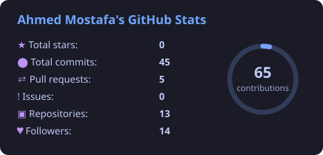
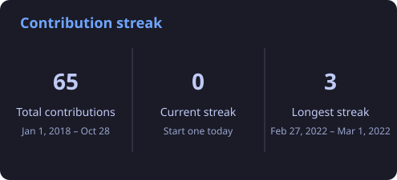
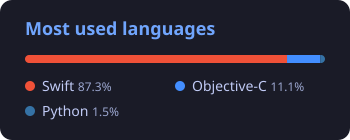

<h1 align="center">Hi 👋, I'm Ahmed Mostafa</h1>
<h3 align="center">iOS Developer at <a href="https://www.klivvr.com">Klivvr</a> · Swift · SwiftUI · Clean Architecture</h3>

  
  
  

I'm a mobile developer based in Egypt with experience across the whole lifecycle: analysis, design, development, implementation and testing. I specialise in building apps for iOS.

- 💼 Building fintech at **Klivvr**
- 📱 Currently working on **EGMoney**, a personal finance tracker:
  - a React PWA, [justnegm/egmoneytracker](https://github.com/justnegm/egmoneytracker)
  - a native iOS app in SwiftUI
- 🧱 I care about clean architecture, MVVM with coordinators, modern Swift concurrency and well-tested code
- 📄 [My CV](https://drive.google.com/file/d/1vCoIq2PwTzV5hAT6YbB44t-dPhcr0sHn/view?usp=share_link)

### 🛠 Tech I use

  
  
  
  
  
  
  
  
  
  
  
  
  

### 📊 GitHub stats

  
  

  

Stats refresh daily via a GitHub Action in this repo.

